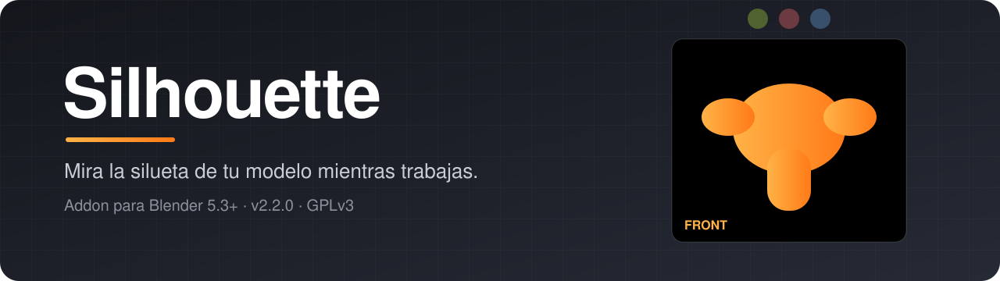
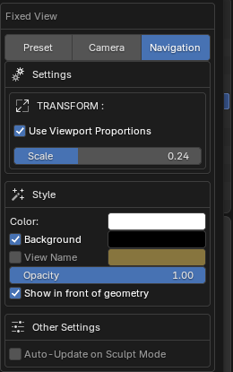
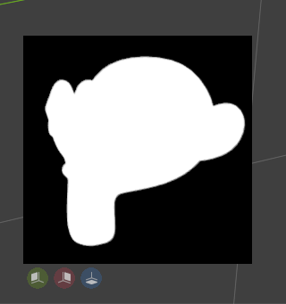
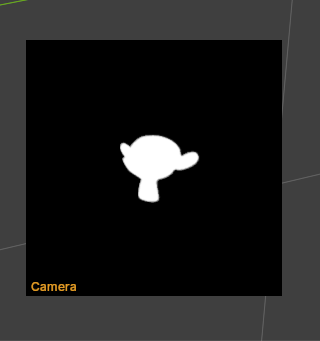
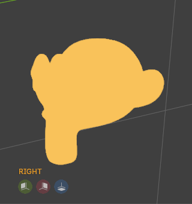

  

<h1 align="center">📖 Documentación</h1>

  <a href="#1-activar-silhouette">Activar</a> ·
  <a href="#2-el-panel">Panel</a> ·
  <a href="#3-modos-de-vista">Modos de vista</a> ·
  <a href="#4-objetivo-target">Objetivo</a> ·
  <a href="#5-estilo">Estilo</a> ·
  <a href="#6-sculpt">Sculpt</a> ·
  <a href="#7-preferencias">Preferencias</a> ·
  <a href="#8-preguntas-frecuentes">FAQ</a>

---

## 1. Activar Silhouette

En la cabecera del viewport 3D, a la derecha, aparece un **fantasma** 👻 y una pequeña flecha.

| Control | Qué hace |
|:---:|---|
| 👻 | Enciende o apaga la silueta en el viewport. |
| ⌄ | Abre el panel con todos los ajustes. |

Con la silueta encendida verás una tarjeta en la esquina inferior izquierda del viewport:

  

Debajo de la tarjeta hay tres botones para cambiar rápido de vista:

<table align="center">
  <tr>
    <td align="center">🟢 <b>Frontal</b></td>
    <td align="center">🔴 <b>Lateral</b> (derecha)</td>
    <td align="center">🔵 <b>Superior</b></td>
  </tr>
</table>

---

## 2. El panel

<table>
  <tr>
    <td width="40%" align="center"></td>
    <td>

- **Preset / Camera / Navigation**: el modo de vista ([ver abajo](#3-modos-de-vista)).
- **Settings**: vista, objetivo y tamaño. Cambia según el modo.
- **Style**: cómo se pinta la silueta.
- **Other Settings**: auto-refresco en sculpt.

</td>
  </tr>
</table>

---

## 3. Modos de vista

| Modo | Cómo se ve | Cuándo usarlo |
|---|---|---|
| **Preset** | Ortográfica, encuadrada automáticamente sobre el objetivo. | Comprobar la forma desde los ejes: Front, Back, Left, Right, Top, Bottom. |
| **Camera** | Desde la cámara activa de la escena, o desde la que elijas. | Tener fija una vista concreta, por ejemplo la del plano final. |
| **Navigation** | Exactamente tu vista del viewport, con su mismo encuadre y perspectiva. | Ver la silueta mientras navegas o esculpes. Se actualiza sola. |

<table>
  <tr>
    <td align="center"> Preset · Front</td>
    <td align="center"> Preset · Right</td>
    <td align="center"> Camera · cámara de la escena</td>
  </tr>
</table>

   
  Modo Navigation: la tarjeta muestra lo mismo que el viewport, en silueta.

**Transform**

- **Dimensions**: ancho y alto de la tarjeta en píxeles (de 64 a 1024).
- En *Navigation* puedes marcar **Use Viewport Proportions** para que la tarjeta tenga la misma proporción que el viewport y ajustar solo la **Scale**. Si usas dimensiones manuales con otra proporción, el modelo no se deforma: simplemente se ve más o menos espacio por los lados.

---

## 4. Objetivo (Target)

Solo en modo *Preset*. Decide qué se encuadra:

| Tipo | Encuadra |
|---|---|
| **Active Object** | El objeto activo (por defecto). |
| **Selected Objects** | Todas las mallas seleccionadas a la vez. |
| **Fixed Object** | Un objeto concreto, aunque cambies de selección. |
| **Collection** | Todas las mallas de una colección. |

> [!TIP]
> *Fixed Object* va muy bien cuando trabajas en piezas sueltas de un personaje pero quieres seguir viendo la silueta del cuerpo completo.

---

## 5. Estilo

| Opción | Efecto |
|---|---|
| **Color** | Color de la silueta. |
| **Background** | Si está apagado, el fondo es transparente y solo se ve la forma. El color de al lado es el del fondo. |
| **View Name** | Escribe el nombre de la vista (FRONT, RIGHT...) o de la cámara en la esquina. |
| **Opacity** | Transparencia de toda la tarjeta. |
| **Show in front of geometry** | Dibuja la silueta por encima de los objetos y la rejilla. Activado por defecto. |

   
  Silueta naranja, fondo transparente y nombre de vista.

---

## 6. Sculpt

En modo Sculpt Blender no avisa de cada trazo, así que la silueta de los modos *Preset* y *Camera* no se entera sola.

- **Toca la silueta** con el ratón para refrescarla a mano. Verás el aviso *Tap to refresh!*.
- O activa **Auto-Update on Sculpt Mode** para que se refresque cada 5 segundos.
- El modo [Navigation](#3-modos-de-vista) se redibuja con el viewport, así que va siempre al día.

---

## 7. Preferencias

En **Edit ▸ Preferences ▸ Add-ons ▸ Silhouette** puedes definir el estilo por defecto de la silueta.

---

## 8. Preguntas frecuentes

<b>No veo nada al activar el fantasma</b>

Asegúrate de tener una malla como objeto activo (o un objetivo válido) y de estar en modo *Preset*. En modo *Camera* la escena necesita una cámara activa (o elige una en el panel).

<b>La rejilla del suelo se ve por encima de la silueta</b>

Activa **Show in front of geometry** en el estilo (viene activado por defecto).

<b>¿Funciona en Blender 4.x o 2.93?</b>

La 2.2 está pensada para 5.3 en adelante. Para 2.93 descarga la release 2.1 desde la página de releases.

<a href="README.md">⬅ Volver al README</a>

