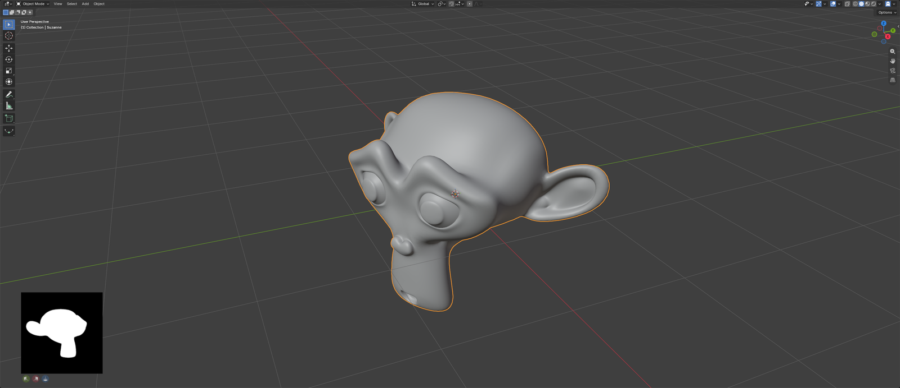
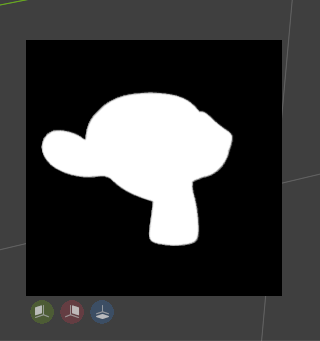
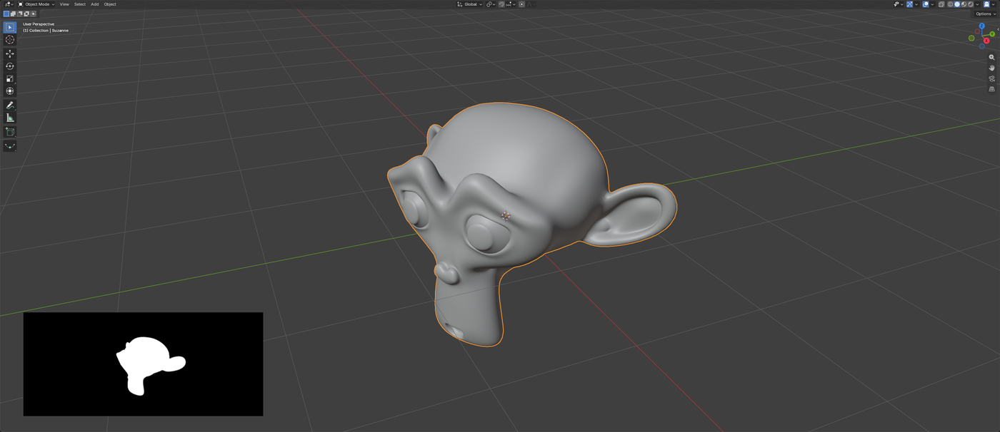

  

<h1 align="center">📖 Documentation</h1>

  💛 Silhouette is free and made by an independent developer. 
  You can support its development by getting it on <a href="https://superhivemarket.com/products/silhouette"><b>SuperHive</b></a>.

  <a href="#1-turning-it-on">Turning it on</a> ·
  <a href="#2-the-panel">Panel</a> ·
  <a href="#3-view-modes">View modes</a> ·
  <a href="#4-target">Target</a> ·
  <a href="#5-style">Style</a> ·
  <a href="#6-sculpting">Sculpting</a> ·
  <a href="#7-preferences">Preferences</a> ·
  <a href="#8-faq">FAQ</a>

---

## 1. Turning it on

On the right side of the 3D viewport header you'll find a **ghost** 👻 and a small arrow.

| Control | What it does |
|:---:|---|
| 👻 | Turns the silhouette on or off in the viewport. |
| ⌄ | Opens the panel with all the settings. |

With the silhouette on, you'll see a card in the bottom-left corner of the viewport:

  

Below the card there are three buttons to quickly switch views:

<table align="center">
  <tr>
    <td align="center">🟢 <b>Front</b></td>
    <td align="center">🔴 <b>Side</b> (right)</td>
    <td align="center">🔵 <b>Top</b></td>
  </tr>
</table>

---

## 2. The panel

<table>
  <tr>
    <td width="40%" align="center"></td>
    <td>

- **Preset / Camera / Navigation**: the view mode ([see below](#3-view-modes)).
- **Settings**: view, target and size. Changes depending on the mode.
- **Style**: how the silhouette is drawn.
- **Other Settings**: auto-refresh in sculpt mode (Preset and Camera only, Navigation doesn't need it).

</td>
  </tr>
</table>

---

## 3. View modes

| Mode | What you see | When to use it |
|---|---|---|
| **Preset** | Orthographic, automatically framed around the target. | Checking the shape along the axes: Front, Back, Left, Right, Top, Bottom. |
| **Camera** | From the active scene camera, or from the one you pick. | Keeping a specific view fixed, like your final shot. |
| **Navigation** | Exactly your viewport view, same framing and perspective. | Watching the silhouette while you navigate or sculpt. Updates on its own. |

<table>
  <tr>
    <td align="center"> Preset · Front</td>
    <td align="center"> Preset · Right</td>
    <td align="center"> Camera · scene camera</td>
  </tr>
</table>

   
  Navigation mode: the card shows the same as the viewport, as a silhouette.

**Transform**

- **Dimensions**: width and height of the card in pixels (64 to 1024).
- In *Navigation* you can enable **Use Viewport Proportions** so the card matches the viewport's aspect ratio and you only tweak the **Scale**. If you use manual dimensions with a different ratio, the model doesn't get stretched: you just see more or less space on the sides.

---

## 4. Target

*Preset* mode only. Decides what gets framed:

| Type | Frames |
|---|---|
| **Active Object** | The active object (default). |
| **Selected Objects** | Every selected mesh at once. |
| **Fixed Object** | One specific object, even if you change the selection. |
| **Collection** | Every mesh in a collection. |

> [!TIP]
> *Fixed Object* is great when you're working on separate pieces of a character but still want to see the silhouette of the whole body.

---

## 5. Style

| Option | Effect |
|---|---|
| **Color** | Silhouette color. |
| **Background** | When off, the background is transparent and only the shape is visible. The color next to it is the background color. |
| **View Name** | Writes the view name (FRONT, RIGHT...) or the camera name in the corner. |
| **Opacity** | Transparency of the whole card. |
| **Show in front of geometry** | Draws the silhouette on top of objects and the grid. On by default. |

   
  Orange silhouette, transparent background and view name.

---

## 6. Sculpting

In Sculpt mode Blender doesn't report every stroke, so the silhouette in *Preset* and *Camera* modes can't tell on its own that the mesh changed.

- **Click the silhouette** to refresh it manually. You'll see the *Tap to refresh!* hint.
- Or enable **Auto-Update on Sculpt Mode** to refresh it every 5 seconds. This option only shows up in Preset and Camera.
- [Navigation](#3-view-modes) mode redraws along with the viewport, so it's always up to date.

---

## 7. Preferences

In **Edit ▸ Preferences ▸ Add-ons ▸ Silhouette** you can set the default silhouette style.

---

## 8. FAQ

<b>I don't see anything when I click the ghost</b>

Make sure you have a mesh as the active object (or a valid target) and that you're in *Preset* mode. In *Camera* mode the scene needs an active camera (or pick one in the panel).

<b>The floor grid shows on top of the silhouette</b>

Enable **Show in front of geometry** in the style settings (it's on by default).

<b>Does it work in Blender 4.x or 2.93?</b>

2.2 is built for 5.3 and newer. For 2.93, grab the 2.1 release from the releases page.

<a href="README.md">⬅ Back to README</a>

