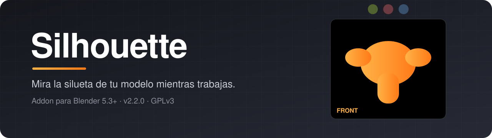
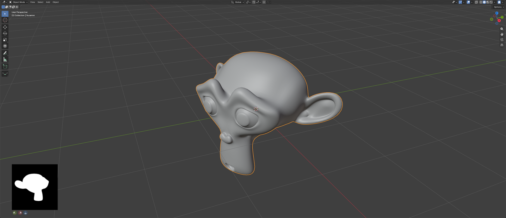
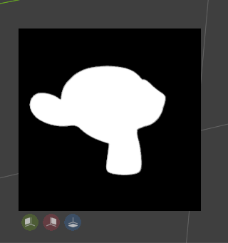
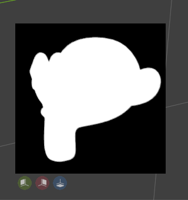
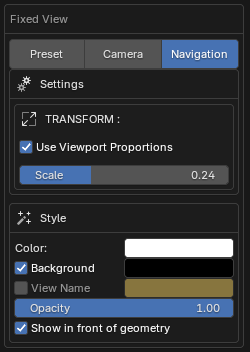
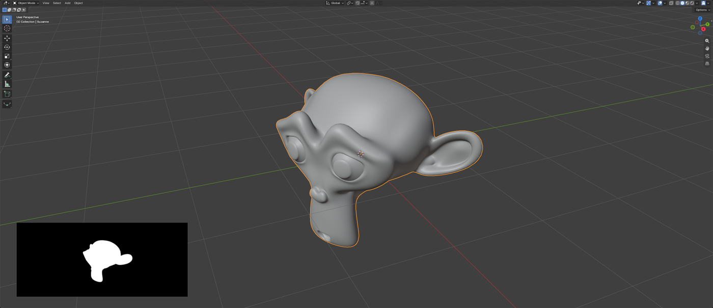

  

  
  
  
  

  <b>Silhouette</b> draws a flat, detail-free view of your mesh on top of the viewport, 
  so you can tell at a glance whether the shape reads well from the front, the side or the top.

  <a href="#-installation"><b>Installation</b></a> ·
  <a href="#-what-it-does"><b>What it does</b></a> ·
  <a href="https://jfranmatheu.github.io/Blender-Silhouette/"><b>🌐 Website</b></a> ·
  <a href="DOCS.md"><b>Documentation</b></a> ·
  <a href="https://github.com/jfranmatheu/Blender-Silhouette/releases"><b>Downloads</b></a>

 

  

---

## ✨ What it does

<table>
  <tr>
    <td width="33%" align="center">
       
      <b>Preset views</b> 
      Front, back, left, right, top and bottom. Switch between them with the three colored buttons.
    </td>
    <td width="33%" align="center">
       
      <b>Your own style</b> 
      Color, transparent or solid background, opacity and the view name in a corner.
    </td>
    <td width="33%" align="center">
       
      <b>All in one panel</b> 
      The ghost button in the viewport header turns it on, and the little arrow opens the settings.
    </td>
  </tr>
</table>

   
  <b>Navigation mode</b>: the silhouette of what you're looking at, framed exactly like the viewport, following you while you navigate or sculpt.

| | |
|---|---|
| 🎯 **Targets** | Active object, selected objects, a fixed object or a whole collection. |
| 🎥 **View modes** | *Preset* (orthographic views), *Camera* (the scene camera or any camera you pick) and *Navigation* (your viewport view, as is). |
| 🗿 **Sculpt** | Click the silhouette to refresh it, or turn on auto-refresh every few seconds. |
| ⚡ **Lightweight** | It only re-renders when something changes (location, scale, rotation, mesh...). |

## 📦 Installation

> [!IMPORTANT]
> This version requires **Blender 5.3 or newer**. For Blender 2.93 use the [2.1 release](https://github.com/jfranmatheu/Blender-Silhouette/releases/tag/v2.1).

1. Download `silhouette_v2.2.0_blender-5.3.zip` from the [latest release](https://github.com/jfranmatheu/Blender-Silhouette/releases/latest).
2. In Blender: **Edit ▸ Preferences ▸ Get Extensions ▸ ⌄ ▸ Install from Disk...** and pick the zip (or just drag it onto the Blender window).
3. Click the 👻 icon in the 3D viewport header. Done.

## 📚 Documentation

The full guide with screenshots lives in **[DOCS.md](DOCS.md)** and on the **[website](https://jfranmatheu.github.io/Blender-Silhouette/)**: every panel option, the view modes and some sculpting tips.

## 🛠️ What's new in 2.2

- Ported to **Blender 5.3**: `bgl` is gone and all drawing goes through the `gpu` module, so it works on Vulkan, OpenGL and Metal.
- Shaders rewritten with `GPUShaderCreateInfo`.
- **Navigation** mode now uses the real viewport projection: you see the whole model with the same framing, no cropping, and the scene no longer needs a camera.
- **Camera** mode uses the scene camera by default when you don't pick one.
- The old live view (beta) is gone: it did the same as Navigation, and the panel is much cleaner now.
- The silhouette is drawn **in front of the geometry** by default.
- Packaged as an **extension** (`blender_manifest.toml`).

## 📄 License

Silhouette is free software released under the **[GNU GPL v3](LICENSE.md)**.

Made with love by <a href="https://github.com/jfranmatheu">@jfranmatheu</a>

